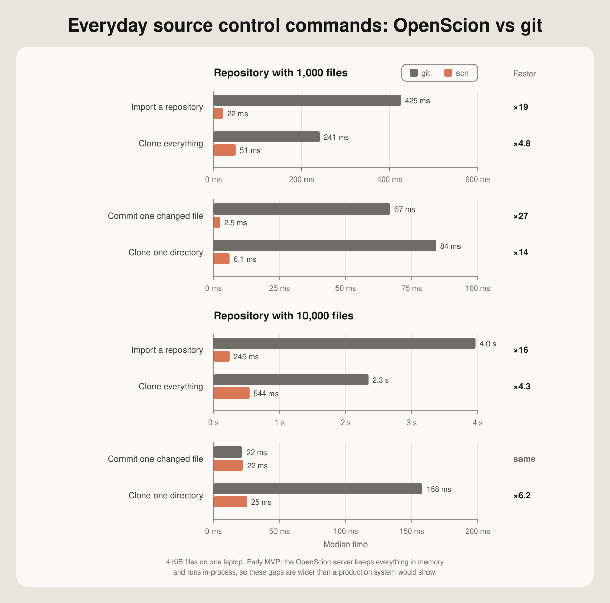

# Benchmarks

`openscion-bench` times the operations developers and CI jobs actually wait for
on a deterministic synthetic repository, against git and against OpenScion,
and prints a Markdown table of median wall-clock times.

```sh
cargo run -p openscion-benchmarks --release
cargo run -p openscion-benchmarks --release -- --directories 50 --files-per-directory 200 --runs 5
```

| Flag | Default | Meaning |
| --- | --- | --- |
| `--directories` | 10 | top-level directories in the fixture |
| `--files-per-directory` | 100 | files in each directory |
| `--file-bytes` | 4096 | size of every file |
| `--seed` | 1 | fixture seed; the same seed produces byte-identical files |
| `--runs` | 5 | runs per scenario; the report shows the median |
| `--workdir` | `target/openscion-bench` | scratch directory, emptied before every run |

## Scenarios

| Scenario | git | OpenScion |
| --- | --- | --- |
| `import` | `init` + `add -A` + `commit` | `scn import`: hash, upload blobs, create the root changeset, create `main` |
| `commit-one-file` | `commit -a` after changing one file | `scn commit` after changing one file |
| `full-clone` | `clone --no-local` | `scn clone`: trees level by level, then blobs in batches |
| `sparse-clone` | partial clone (`--filter=blob:none --sparse`) + `sparse-checkout set dir0000` | `scn clone --path dir0000` |

Setup a scenario does not measure — writing the fixture, the import a commit or
clone starts from, starting the server — runs before the clock starts. Both
backends' clones are checked byte for byte against the fixture in
`tests/scenarios.rs`.

## Results

Apple Silicon laptop, release build, 4 KiB files, `--runs 7` (1,000 files) and
`--runs 5` (10,000 files), measured 2026-10-14:



| Scenario | git, 1k files | OpenScion, 1k | git, 10k files | OpenScion, 10k |
| --- | ---: | ---: | ---: | ---: |
| import | 425 ms | 21.9 ms | 3,966 ms | 245 ms |
| commit-one-file | 66.9 ms | 2.5 ms | 21.8 ms | 22.3 ms |
| full-clone | 241 ms | 50.7 ms | 2,343 ms | 544 ms |
| sparse-clone | 84.2 ms | 6.1 ms | 158 ms | 25.3 ms |

## Read these numbers with the caveats

This is an early, in-memory build measured against mature, durable software. The comparison is
not like for like, and the gaps above are larger than a production OpenScion
would show:

- **No disk on the OpenScion side.** The server keeps every object in memory
  and never fsyncs or compresses. Git zlib-compresses every object and writes
  it to its object store. Most of the `import` gap is this.
- **No process starts for `scn`.** The OpenScion backend runs the server and
  `scn` in this process, over real loopback HTTP. Git pays a process start for
  every command (about a millisecond each; `import` runs three).
- **No packing.** `git clone` builds and indexes a pack with delta compression,
  so it moves fewer bytes; `scn clone` ships raw objects. On a real network,
  where bytes cost more than CPU, the full-clone gap would narrow or flip.
- **Git's racily-clean index.** In `commit-one-file` on the small fixture,
  every file was written in the same second as git's index, so `commit -a`
  re-hashes them all. On the large fixture the import takes long enough that
  it does not, and git is as fast as `scn` — whose JSON state file costs more
  than git's binary index once there are 10,000 entries.

What holds up despite the caveats is the shape. A sparse clone fetches only
the trees on the path to a directory plus that directory's files, with no
negotiation, so its cost follows the slice and not the repository. That is
the property OpenScion is built around.

Run on a quiet machine with `--release`. CI runs a tiny fixture only to check
that both backends work.
